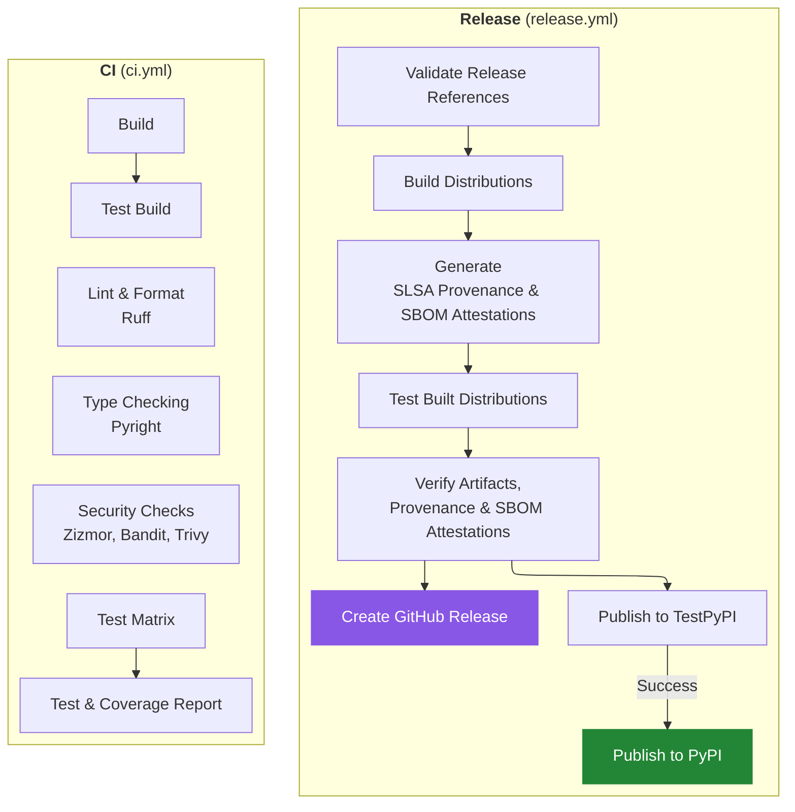
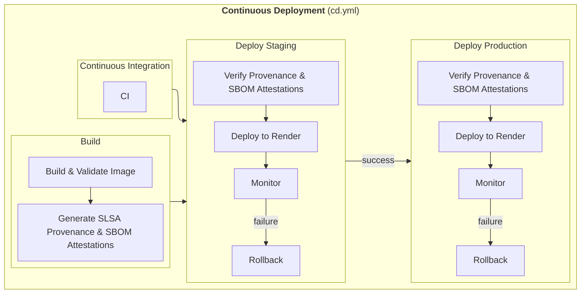
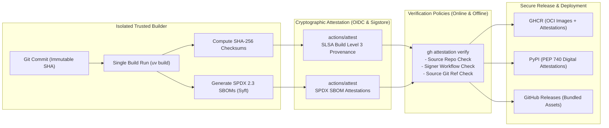

# CI/CD Playground

[](https://github.com/JohnStephens1/ci-cd-playground/actions/workflows/ci.yml)
[](https://github.com/JohnStephens1/ci-cd-playground/actions/workflows/cd.yml)
[](https://github.com/JohnStephens1/ci-cd-playground/actions/workflows/release.yml)
[](https://www.python.org/)
[](https://slsa.dev/)
[](https://spdx.dev/)
[](LICENSE)

**End-to-End CI/CD Engineering Showcase & Practical Reference Implementation**

---

## Overview

**CI/CD Playground is a practical, end-to-end reference implementation of modern CI/CD engineering practices**, built around GitHub Actions and a deliberately minimal Python application. The project focuses on the engineering infrastructure required to automate, secure, and maintain the complete software delivery lifecycle.

It demonstrates how interconnected workflows, quality gates, and security controls can coordinate the following capabilities:

- **Continuous Integration:** Automated testing, coverage reporting, linting, formatting, static type checking, vulnerability scanning, and dependency management.
- **Continuous Deployment:** Automated staging and production deployments on Render, with deployment verification, post-deployment smoke testing, and automatic rollback on failure.
- **Release Automation:** Versioned distribution of Python packages to TestPyPI and PyPI, Docker images to GitHub Container Registry, and source releases through GitHub Releases.
- **Supply-Chain Security:** OIDC-based authentication, PyPI trusted publishing, SBOM generation, SLSA provenance, cryptographic signing, and GitHub artifact attestations with automated verification.
- **Operational Reliability:** Automated health checks, deployment validation, controlled production promotion, and recovery mechanisms.

The repository provides an inspectable, functional implementation of these practices, illustrating how individual components integrate into a cohesive delivery architecture. Its workflows and configurations serve as both a practical learning resource and an adaptable foundation for building secure, reliable, and automated CI/CD pipelines.

### Deployments

- **Staging:** [ci-cd-playground-staging](<https://ci-cd-playground-staging.onrender.com/>)
- **Production:** [ci-cd-playground-production](<https://ci-cd-playground-production.onrender.com/>)

**Note:** The services might take a second to wake up if they haven't been accessed recently.

---

## System Architecture & Delivery Lifecycle

The software delivery lifecycle spans three distinct execution phases, each governed by cryptographic verification, automated testing, and quality gates:

See [workflow architecture](docs/architecture.md) for details.





---

## Software Supply Chain Security

The GitHub Actions CI/CD pipelines implement defense-in-depth software supply-chain security mechanisms:



- **SLSA Provenance Generation**: Build provenance attestations are generated for Docker container images and Python distribution artifacts (both `.whl` and `.tar.gz`), meeting **SLSA v1.0 Build Level 3** requirements through build isolation and single-job execution.
- **SBOM Generation**: Full Software Bill of Materials (SBOM) documents in SPDX 2.3 format are generated independently for container images and both Python packages using Anchore Syft, outputting both machine-readable JSON and human-readable summary tables.
- **GitHub Artifact Attestations**: GitHub's native artifact attestation mechanism (`actions/attest`) is leveraged to bind signed SLSA provenance and SBOM attestations to exact cryptographic digests.
- **Cryptographic Signing**: Attestations are cryptographically signed using GitHub's keyless signing infrastructure, backed by short-lived OpenID Connect (OIDC) identity tokens and Sigstore public transparency logs.
- **Signature & Attestation Verification**: Built-in verification steps use the GitHub CLI (`gh attestation verify`) to cryptographically validate artifact attestations both online against Sigstore and offline using bundled `.intoto.jsonl` and `.attestation.json` files.
- **Provenance Identity & Source Verification**: Strict verification policies enforce constraints against the expected source repository (`JohnStephens1/ci-cd-playground`), the exact trusted signer workflow (`package-build.yml` or `docker-publish.yml`), and the source Git reference (`refs/heads/main` or target release tag).
- **Published Artifact Verification**: Container image attestations are verified against immutable OCI image digests (`sha256:...`) before cloud deployment. Python distribution attestations are verified independently for both wheel and sdist packages prior to PyPI publication.
- **Credential-less Authentication**: All package publishing to TestPyPI and PyPI utilizes OIDC Trusted Publishing, eliminating long-lived secrets, static API tokens, and passwords from the CI/CD environment.
- **Automated Workflow & SAST Auditing**: GitHub Actions workflows are continuously audited for misconfigurations, permission leaks, and injection vulnerabilities using `zizmor`, while application source code undergoes Static Application Security Testing via `bandit`.

---

## GitHub Actions Workflows & Pipeline Architecture

The repository's automation is organized into modular, reusable, and decoupled workflows with minimal permissions (`permissions: {}` by default):

See [workflows](docs/workflows.md) for details.

### 1. Continuous Integration — [`.github/workflows/ci.yml`](.github/workflows/ci.yml)

Runs on pull requests to `main` and provides comprehensive quality and security validation through linting (`ruff`), static type checking (`pyright`), and multi-version testing (`pytest`) across Python 3.10–3.13. It additionally performs workflow and application security audits (`zizmor`, `bandit`), package build and installation verification, and container security validation.

### 2. Container Security & Image Validation — [`.github/actions/validate-image`](.github/actions/validate-image/action.yaml)

Provides a hardened validation process for container images before publication or deployment. It combines input validation, Trivy vulnerability scanning, sandboxed runtime execution, application health verification, and automated container cleanup to enforce security and operational requirements.

### 3. Docker Build, Publish & Attestation — [`.github/workflows/docker-publish.yml`](.github/workflows/docker-publish.yml)

Builds production container images using Docker Buildx, validates them before registry authentication, and publishes immutable image digests to GitHub Container Registry (GHCR). It also generates and publishes signed **SLSA provenance** and **SPDX SBOM attestations** to establish verifiable build integrity and software supply chain transparency.

### 4. Deploy Service — [`.github/workflows/deploy.yml`](.github/workflows/deploy.yml)

Provides a reusable deployment engine for staging and production environments on Render, deploying exclusively through immutable container digests. It verifies image provenance and SBOM attestations before deployment, monitors deployment status, validates application health and commit identity, and automatically triggers rollback when post-deployment verification fails.

### 5. Operational Recovery & Automated Rollback — [`.github/workflows/rollback.yml`](.github/workflows/rollback.yml)

Provides automated recovery by restoring a previously recorded live Render deployment through its REST API. It monitors the rollback process and performs post-rollback health checks to verify that service availability has been recovered.

### 6. Continuous Delivery — [`.github/workflows/cd.yml`](.github/workflows/cd.yml)

Orchestrates the end-to-end delivery pipeline on pushes to `main` or through manual execution with selectable deployment targets (`both`, `staging`, `production`). It sequentially enforces CI validation, secure container publication, staging deployment, and successful staging verification before promoting the **identical immutable image digest** to production.

### 7. Trusted Package Builder (SLSA Level 3) — [`.github/workflows/package-build.yml`](.github/workflows/package-build.yml)

Builds Python wheel and source distribution artifacts exactly once in an isolated, trusted build environment. It generates SHA-256 checksums, individual SPDX SBOMs, and signed **SLSA Level 3 provenance and SBOM attestations**, preserving all artifacts as pipeline outputs for independent verification.

### 8. Release & Multi-Channel Distribution — [`.github/workflows/release.yml`](.github/workflows/release.yml)

Automates verified Python package releases from semantic version tags or manual execution, enforcing consistency between Git tags and project metadata. It validates artifact integrity, provenance, SBOMs, and clean-room installations before publishing to **TestPyPI and PyPI** through trusted publishing, then creates a GitHub Release containing distributions and associated verification artifacts.

### 9. Dependency Maintenance — [`.github/dependabot.yml`](.github/dependabot.yml)

Automates weekly dependency updates and vulnerability mitigation across Python packages (`uv`), GitHub Actions, and Docker base images. It groups minor and patch updates, applies cooldown policies, and tracks GitHub Actions pinned to immutable commit SHAs.

---

## Consumer & Evaluator Verification Guide

Downstream consumers, security evaluators, and auditors can independently verify the authenticity, integrity, SLSA Build Level 3 provenance, and SBOM attestations of released artifacts without placing blind trust in build claims.

See [verification](docs/verification.md) for details.

### Verify Published Container Images (GHCR)

Verify container image provenance and SBOM attestations against immutable image digests:

```bash
# Verify container SLSA provenance
gh attestation verify \
  "oci://ghcr.io/johnstephens1/ci-cd-playground@<IMAGE_DIGEST>" \
  --repo JohnStephens1/ci-cd-playground \
  --signer-workflow JohnStephens1/ci-cd-playground/.github/workflows/docker-publish.yml \
  --source-ref "refs/heads/main"

# Verify container SBOM attestation
gh attestation verify \
  "oci://ghcr.io/johnstephens1/ci-cd-playground@<IMAGE_DIGEST>" \
  --repo JohnStephens1/ci-cd-playground \
  --signer-workflow JohnStephens1/ci-cd-playground/.github/workflows/docker-publish.yml \
  --source-ref "refs/heads/main" \
  --predicate-type https://spdx.dev/Document/v2.3
```

---

## Demonstration Application & Endpoints

The demonstration vehicle is deliberately lean, providing a lightweight, responsive surface for automated testing, container sandboxing, and deployment verification:

- **Backend**: Python 3.10+ application built with FastAPI and Uvicorn.
- **Frontend**: Static canvas served with p5.js generative animations via FastAPI `StaticFiles`.
- **Container**: Multi-stage build based on `python:3.13-slim`, running with an unprivileged non-root user (`app:10001:10001`) and read-only root filesystem support.

| Endpoint | Method | Response / Description |
| :--- | :--- | :--- |
| `/` | `GET` | Static interactive p5.js animation frontend (`index.html`) |
| `/health` | `GET` | Health verification endpoint returning `{"status": "ok"}` |
| `/version` | `GET` | Deployment metadata returning `{"version": "...", "commit": "..."}` |
| `/hello/{name}` | `GET` | Parametric greeting endpoint returning `{"message": "Hello, {name}!"}` |
| `/docs` | `GET` | Interactive Swagger / OpenAPI documentation UI |

---

## Local Development & Quality Engineering

See [local development](docs/local_development.md) for details.

### Local Quality & Security Commands

All checks and tools run through `uv`:

| Category | Tool | Command | Description |
| :--- | :--- | :--- | :--- |
| **Linting** | Ruff | `uv run ruff check .` | Executes linting rules and imports ordering |
| **Linting (Fix)** | Ruff | `uv run ruff check --fix .` | Automatically fixes auto-fixable lint issues |
| **Formatting** | Ruff | `uv run ruff format --check .` | Verifies code conforms to formatting standards |
| **Formatting (Fix)** | Ruff | `uv run ruff format .` | Formats all source files |
| **Type Checking** | Pyright | `uv run pyright` | Runs static type analysis in standard mode |
| **Testing** | Pytest | `uv run pytest` | Runs unit tests with test summaries |
| **Coverage** | Pytest-Cov | `uv run pytest --cov=ci_cd_playground --cov-branch --cov-report=term-missing` | Runs tests with branch coverage metrics |
| **SAST Scan** | Bandit | `uv run bandit -c pyproject.toml -r src` | Scans Python code for security vulnerabilities |
| **Workflow Audit**| Zizmor | `uv run zizmor --format=github .` | Audits GitHub Actions workflows for security hazards |
| **Pre-commit** | pre-commit | `uv run pre-commit run --all-files` | Runs local git hooks (ruff, yamllint, actionlint) |
| **Packaging** | uv build | `uv build` | Builds sdist and wheel packages into `dist/` |

---

## Repository Structure

```text
ci-cd-playground/
├── .github/
│   ├── actions/
│   │   └── validate-image/         # Composite action for container Trivy scan & smoke test
│   │       └── action.yaml
│   ├── workflows/
│   │   ├── cd.yml                  # Continuous delivery pipeline (main -> staging -> production)
│   │   ├── ci.yml                  # Reusable CI workflow (lint, typecheck, matrix test, SAST, build)
│   │   ├── deploy.yml              # Reusable Render deployment workflow with attestation verify
│   │   ├── docker-publish.yml      # Reusable Docker build, test, publish & attestation to GHCR
│   │   ├── package-build.yml       # Reusable SLSA Level 3 builder (uv build, Syft SBOMs, attestations)
│   │   ├── release.yml             # Release pipeline (validation, test, verify, TestPyPI, PyPI, GitHub)
│   │   └── rollback.yml            # Automated operational recovery & rollback workflow
│   ├── actionlint.yaml             # Actionlint workflow linter configuration
│   └── dependabot.yml              # Automated dependency maintenance schedule (uv, actions, docker)
|
├── ...                             # Other project configuration and tooling
|
├── src/ci_cd_playground/           # FastAPI application
├── static/                         # Frontend
├── tests/                          # Tests
├── Dockerfile                      # Hardened multi-stage non-root container definition
└── pyproject.toml                  # Project metadata, dependencies, and tool configurations
```

---

## Design Principles & Engineering Decisions

1. **Infrastructure as the Primary Product**: The application codebase is kept deliberately minimal. The value of this repository lies in its CI/CD workflows, supply-chain attestations, automated rollbacks, and release architecture.
2. **Build Once, Attest Once, Deploy Everywhere**: Artifacts (both Python distributions and container images) are built strictly once during their respective pipelines. Downstream stages consume identical, immutable artifacts verified by cryptographic digests rather than rebuilding from source.
3. **Least-Privilege Security Architecture**: Workflows define `permissions: {}` at top-level scope, explicitly granting minimal necessary permissions (such as `contents: read`, `id-token: write`, or `attestations: write`) strictly to individual jobs.
4. **Keyless Provenance & OIDC Authentication**: No long-lived PyPI tokens or static credentials are stored in repository secrets for package distribution. All publishing operations authenticate via short-lived OIDC exchange backed by Sigstore transparency logs.
5. **Zero-Trust Deployment Gates**: The deployment workflow validates both SLSA provenance and SBOM attestations of OCI container images *before* initiating any cloud deployment, ensuring that only verified artifacts reach staging and production.
6. **Automated Operational Recovery**: Deployments are coupled with active smoke tests verifying both system health (`/health`) and deployed commit identity (`/version`). If an anomalous deployment reaches live status, the automated rollback workflow immediately restores the previous known-good deployment without manual intervention.

---

## License

This project is licensed under the [MIT License](LICENSE).
