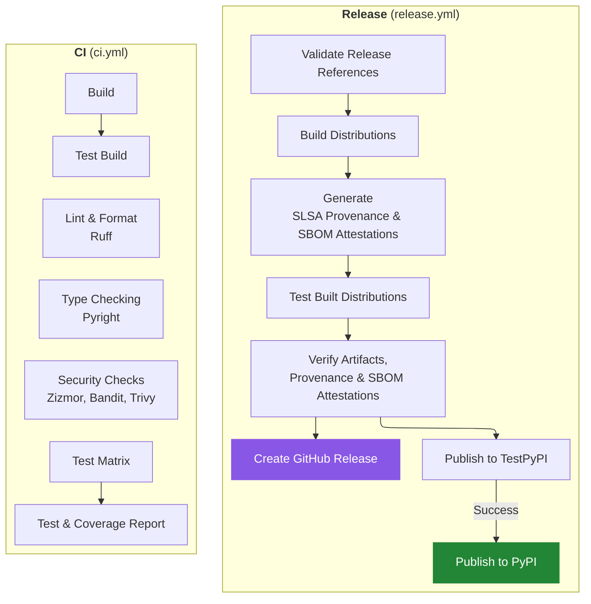
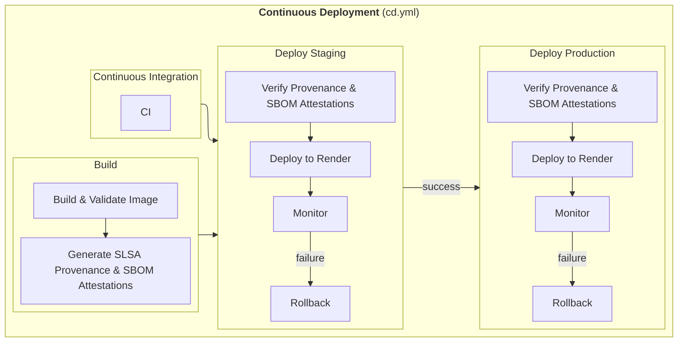
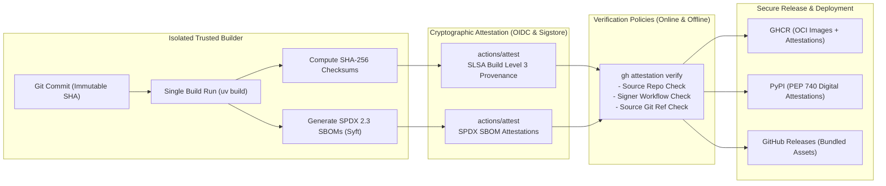

# CI/CD Playground

[](https://github.com/JohnStephens1/ci-cd-playground/actions/workflows/ci.yml)
[](https://github.com/JohnStephens1/ci-cd-playground/actions/workflows/cd.yml)
[](https://github.com/JohnStephens1/ci-cd-playground/actions/workflows/release.yml)
[](https://www.python.org/)
[](https://slsa.dev/)
[](https://spdx.dev/)
[](LICENSE)

**End-to-End CI/CD Engineering Showcase & Practical Reference Implementation**

---

## Overview

**CI/CD Playground is a practical, end-to-end reference implementation of modern CI/CD engineering practices**, built around GitHub Actions and a deliberately minimal Python application. The project focuses on the engineering infrastructure required to automate, secure, and maintain the complete software delivery lifecycle.

It demonstrates how interconnected workflows, quality gates, and security controls can coordinate the following capabilities:

- **Continuous Integration:** Automated testing, coverage reporting, linting, formatting, static type checking, vulnerability scanning, and dependency management.
- **Continuous Deployment:** Automated staging and production deployments on Render, with deployment verification, post-deployment smoke testing, and automatic rollback on failure.
- **Release Automation:** Versioned distribution of Python packages to TestPyPI and PyPI, Docker images to GitHub Container Registry, and source releases through GitHub Releases.
- **Supply-Chain Security:** OIDC-based authentication, PyPI trusted publishing, SBOM generation, SLSA provenance, cryptographic signing, and GitHub artifact attestations with automated verification.
- **Operational Reliability:** Automated health checks, deployment validation, controlled production promotion, and recovery mechanisms.

The repository provides an inspectable, functional implementation of these practices, illustrating how individual components integrate into a cohesive delivery architecture. Its workflows and configurations serve as both a practical learning resource and an adaptable foundation for building secure, reliable, and automated CI/CD pipelines.

---

## System Architecture & Delivery Lifecycle

The software delivery lifecycle spans three distinct execution phases, each governed by cryptographic verification, automated testing, and quality gates:

See [workflow architecture](docs/architecture.md) for details.





---

## Software Supply Chain Security

The GitHub Actions CI/CD pipelines implement defense-in-depth software supply-chain security mechanisms:



- **SLSA Provenance Generation**: Build provenance attestations are generated for Docker container images and Python distribution artifacts (both `.whl` and `.tar.gz`), meeting **SLSA v1.0 Build Level 3** requirements through build isolation and single-job execution.
- **SBOM Generation**: Full Software Bill of Materials (SBOM) documents in SPDX 2.3 format are generated independently for container images and both Python packages using Anchore Syft, outputting both machine-readable JSON and human-readable summary tables.
- **GitHub Artifact Attestations**: GitHub's native artifact attestation mechanism (`actions/attest`) is leveraged to bind signed SLSA provenance and SBOM attestations to exact cryptographic digests.
- **Cryptographic Signing**: Attestations are cryptographically signed using GitHub's keyless signing infrastructure, backed by short-lived OpenID Connect (OIDC) identity tokens and Sigstore public transparency logs.
- **Signature & Attestation Verification**: Built-in verification steps use the GitHub CLI (`gh attestation verify`) to cryptographically validate artifact attestations both online against Sigstore and offline using bundled `.intoto.jsonl` and `.attestation.json` files.
- **Provenance Identity & Source Verification**: Strict verification policies enforce constraints against the expected source repository (`JohnStephens1/ci-cd-playground`), the exact trusted signer workflow (`package-build.yml` or `docker-publish.yml`), and the source Git reference (`refs/heads/main` or target release tag).
- **Published Artifact Verification**: Container image attestations are verified against immutable OCI image digests (`sha256:...`) before cloud deployment. Python distribution attestations are verified independently for both wheel and sdist packages prior to PyPI publication.
- **Credential-less Authentication**: All package publishing to TestPyPI and PyPI utilizes OIDC Trusted Publishing, eliminating long-lived secrets, static API tokens, and passwords from the CI/CD environment.
- **Automated Workflow & SAST Auditing**: GitHub Actions workflows are continuously audited for misconfigurations, permission leaks, and injection vulnerabilities using `zizmor`, while application source code undergoes Static Application Security Testing via `bandit`.

---

## GitHub Actions Workflows & Pipeline Architecture

The repository's automation is organized into modular, reusable, and decoupled workflows with minimal permissions (`permissions: {}` by default):

### 1. Continuous Integration — [`.github/workflows/ci.yml`](.github/workflows/ci.yml)

Runs on pull requests to `main` and functions as a reusable workflow (`workflow_call`):

- **Concurrency Control**: Automatically cancels obsolete in-progress CI runs on active pull requests.
- **Lint & Format Verification (`ruff`)**: Enforces formatting standards and linting rules across all Python modules.
- **Static Type Checking (`pyright`)**: Validates type safety across `src/` and `tests/` targeting Python 3.10+ in standard mode.
- **Multi-Version Test Matrix (`pytest`)**: Executes unit and integration test suites against Python `3.10`, `3.11`, `3.12`, and `3.13` with branch coverage enforcement (fail threshold: 80%), generating JUnit XML and HTML coverage reports, and uploading coverage data to Codecov on Python 3.13.
- **Workflow Security Audit (`zizmor`)**: Scans GitHub Actions workflow definitions for privilege escalation, runner vulnerabilities, and workflow syntax hazards.
- **Static Application Security Testing (`bandit`)**: Scans Python source code against common vulnerability classes.
- **Package Build & Smoke-Test**: Builds distribution packages (`uv build --no-sources`) and installs them in isolated clean-room virtual environments (`.venv-wheel` and `.venv-sdist`) to verify installation integrity and module importability.
- **Docker Security Scan**: On pull requests, triggers container build and vulnerability scanning via the composite image validator.

### 2. Container Security & Image Validation — [`.github/actions/validate-image`](.github/actions/validate-image/action.yaml)

A hardened composite GitHub Action that audits and verifies pre-built container images before publication or deployment:

- **Input Validation**: Sanitizes and validates image tags via POSIX regex rules.
- **Vulnerability Scanning (`trivy`)**: Scans the container filesystem and libraries for `CRITICAL` and `HIGH` vulnerabilities against repository policies (`trivy.yml` and `.trivyignore`).
- **Hardened Runtime Execution**: Launches the container under strict sandboxing flags (`--read-only`, `--cap-drop=ALL`, `--security-opt=no-new-privileges`).
- **Health Verification**: Polls the container's `/health` endpoint until the application is ready, with automatic log dumping on timeout.
- **Automated Teardown**: Guarantees cleanup of ephemeral test containers.

### 3. Docker Build, Publish & Attestation — [`.github/workflows/docker-publish.yml`](.github/workflows/docker-publish.yml)

A reusable workflow (`workflow_call`) encapsulating secure container delivery:

- **Isolated Build**: Builds the production image with `APP_VERSION` and `GIT_SHA` arguments using Docker Buildx.
- **Pre-Publish Validation**: Calls `validate-image` to run Trivy vulnerability scanning and runtime smoke testing before any registry authentication occurs.
- **Immutable Digest Publishing**: Pushes the image to GitHub Container Registry (GHCR) with tags for `${GITHUB_SHA}`, `latest`, and optional semantic tags, recording the immutable `sha256` image digest.
- **SLSA Provenance Attestation**: Attests build provenance via `actions/attest` and publishes the signed attestation directly to GHCR.
- **SBOM Attestation**: Generates an SPDX 2.3 JSON SBOM with Anchore Syft, attests it with `actions/attest`, and pushes the attestation to GHCR.

### 4. Deploy Service — [`.github/workflows/deploy.yml`](.github/workflows/deploy.yml)

A unified, reusable deployment engine (`workflow_call` and manual `workflow_dispatch`) for Render environments:

- **Environment Isolation**: Targets GitHub Environments (`staging` or `production`), enabling environment secrets and optional manual review protection rules.
- **Pre-Deployment Cryptographic Verification**: Verifies SLSA provenance and SBOM attestations of the OCI image directly from GHCR using `gh attestation verify` before initiating deployment.
- **Deployment State Capture**: Queries the Render REST API to record the current live deployment ID for failure recovery.
- **Zero-Trust Deploy Trigger**: Triggers deployment via Render REST API referencing the exact immutable image digest (`imageUrl: ghcr.io/...@sha256:...`).
- **Status Polling**: Monitors Render deployment lifecycle until reaching `live` status or failing.
- **Post-Deployment Health & Version Verification**:
  - Polls `/health` to confirm HTTP 200 and `{"status": "ok"}`.
  - Polls `/version` to ensure the deployed service reports the exact expected Git commit SHA.
- **Automated Rollback Trigger**: If a deployment successfully reaches `live` on Render but fails subsequent health/version smoke tests, it automatically invokes `rollback.yml`.

### 5. Operational Recovery & Automated Rollback — [`.github/workflows/rollback.yml`](.github/workflows/rollback.yml)

A dedicated operational recovery workflow (`workflow_call`):

- **Targeted Rollback**: Communicates with the Render REST API (`/services/{service_id}/rollback`) to roll back the service to the previously recorded live deployment ID.
- **Recovery Monitoring**: Polls deployment status until the rollback build transitions to `live`.
- **Post-Rollback Health Check**: Executes automated health checks against the restored service to guarantee that operational availability has been recovered.

### 6. Continuous Delivery — [`.github/workflows/cd.yml`](.github/workflows/cd.yml)

Triggers automatically on pushes to `main` and via manual `workflow_dispatch` with target selection (`both`, `staging`, `production`):

- **Concurrency Protection**: Enforces non-overlapping deployment runs (`cancel-in-progress: false`) to prevent race conditions across environments.
- **Sequential Quality Gating**:
  1. `ci`: Validates linting, typing, matrix tests, and security audits.
  2. `docker-publish`: Builds, scans, publishes, and attests the container image.
  3. `deploy-staging`: Deploys to the staging environment and verifies health/commit.
  4. `deploy-production`: Requires staging success before promoting the identical image digest to production.

### 7. Trusted Package Builder (SLSA Level 3) — [`.github/workflows/package-build.yml`](.github/workflows/package-build.yml)

A reusable builder workflow (`workflow_call`) that enforces isolation and build platform integrity:

- **Single-Run Build**: Builds source distribution (`.tar.gz`) and wheel (`.whl`) strictly once using `uv build --no-sources`.
- **Cryptographic Digest Computation**: Generates `checksums/SHA256SUMS` for distribution artifacts.
- **Individual SBOM Generation**: Generates independent SPDX 2.3 JSON and human-readable text SBOMs for wheel and sdist using Anchore Syft.
- **SLSA Build Provenance Attestation**: Generates signed SLSA Level 3 provenance via `actions/attest`, bound to both distribution digests and exported to `attestations/package-provenance.intoto.jsonl`.
- **Individual SBOM Attestations**: Cryptographically signs each package's SBOM independently, binding them to their respective distribution digests.
- **Artifact Bundling**: Preserves all binaries, SBOMs, attestations, and checksums as pipeline artifacts.

### 8. Release & Multi-Channel Distribution — [`.github/workflows/release.yml`](.github/workflows/release.yml)

Triggers on semantic version tags (`v*`) or manual `workflow_dispatch`:

- **Reference & Version Validation**: Cryptographically verifies tag resolution to commit SHA and validates that the Git tag strictly matches `project.version` in `pyproject.toml`.
- **Trusted Builder Invocation**: Calls `package-build.yml` to produce immutable artifacts and attestations.
- **Clean-Room Testing**: Installs built wheel and sdist packages into isolated virtual environments to verify runtime execution.
- **Comprehensive Pre-Distribution Verification**:
  - Verifies SHA-256 digests against `SHA256SUMS`.
  - Verifies SLSA provenance and SBOM attestations online via GitHub API / Sigstore and offline using bundled attestation files.
  - Enforces `--signer-workflow` restrictions.
  - Validates SPDX JSON schemas and human-readable SBOM contents.
- **TestPyPI Publishing**:
  - Publishes distributions using OIDC Trusted Publishing.
  - Performs clean-room installation smoke testing from TestPyPI.
- **Production PyPI Publishing**:
  - Gated by the `pypi` GitHub Environment.
  - Generates PEP 740 digital provenance attestations via `astral-sh/attest-action`.
  - Publishes distributions to PyPI via `uv publish`.
- **GitHub Release Creation**: Publishes release notes and attaches distributions (`dist/`), SBOMs (`sbom/`), cryptographic attestations (`attestations/`), and checksums (`checksums/SHA256SUMS`).

### 9. Dependency Maintenance — [`.github/dependabot.yml`](.github/dependabot.yml)

Automates weekly vulnerability mitigation and dependency updates with cooldowns:

- **Python Ecosystem (`uv`)**: Monitors and groups minor and patch updates for application dependencies.
- **GitHub Actions**: Tracks action updates pinned to commit SHAs.
- **Docker**: Scans base container image versions for security patches.

---

## Consumer & Evaluator Verification Guide

Downstream consumers, security evaluators, and auditors can independently verify the authenticity, integrity, SLSA Build Level 3 provenance, and SBOM attestations of released artifacts without placing blind trust in build claims.

See [verification](docs/verification.md) for details.

### Verify Published Container Images (GHCR)

Verify container image provenance and SBOM attestations against immutable image digests:

```bash
# Verify container SLSA provenance
gh attestation verify \
  "oci://ghcr.io/johnstephens1/ci-cd-playground@<IMAGE_DIGEST>" \
  --repo JohnStephens1/ci-cd-playground \
  --signer-workflow JohnStephens1/ci-cd-playground/.github/workflows/docker-publish.yml \
  --source-ref "refs/heads/main"

# Verify container SBOM attestation
gh attestation verify \
  "oci://ghcr.io/johnstephens1/ci-cd-playground@<IMAGE_DIGEST>" \
  --repo JohnStephens1/ci-cd-playground \
  --signer-workflow JohnStephens1/ci-cd-playground/.github/workflows/docker-publish.yml \
  --source-ref "refs/heads/main" \
  --predicate-type https://spdx.dev/Document/v2.3
```

---

## Demonstration Application & Endpoints

The demonstration vehicle is deliberately lean, providing a lightweight, responsive surface for automated testing, container sandboxing, and deployment verification:

- **Backend**: Python 3.10+ application built with FastAPI and Uvicorn.
- **Frontend**: Static canvas served with p5.js generative animations via FastAPI `StaticFiles`.
- **Container**: Multi-stage build based on `python:3.13-slim`, running with an unprivileged non-root user (`app:10001:10001`) and read-only root filesystem support.

| Endpoint | Method | Response / Description |
| :--- | :--- | :--- |
| `/` | `GET` | Static interactive p5.js animation frontend (`index.html`) |
| `/health` | `GET` | Health verification endpoint returning `{"status": "ok"}` |
| `/version` | `GET` | Deployment metadata returning `{"version": "...", "commit": "..."}` |
| `/hello/{name}` | `GET` | Parametric greeting endpoint returning `{"message": "Hello, {name}!"}` |
| `/docs` | `GET` | Interactive Swagger / OpenAPI documentation UI |

---

## Local Development & Quality Engineering

See [local development](docs/local_development.md) for details.

### Local Quality & Security Commands

All checks and tools run through `uv`:

| Category | Tool | Command | Description |
| :--- | :--- | :--- | :--- |
| **Linting** | Ruff | `uv run ruff check .` | Executes linting rules and imports ordering |
| **Linting (Fix)** | Ruff | `uv run ruff check --fix .` | Automatically fixes auto-fixable lint issues |
| **Formatting** | Ruff | `uv run ruff format --check .` | Verifies code conforms to formatting standards |
| **Formatting (Fix)** | Ruff | `uv run ruff format .` | Formats all source files |
| **Type Checking** | Pyright | `uv run pyright` | Runs static type analysis in standard mode |
| **Testing** | Pytest | `uv run pytest` | Runs unit tests with test summaries |
| **Coverage** | Pytest-Cov | `uv run pytest --cov=ci_cd_playground --cov-branch --cov-report=term-missing` | Runs tests with branch coverage metrics |
| **SAST Scan** | Bandit | `uv run bandit -c pyproject.toml -r src` | Scans Python code for security vulnerabilities |
| **Workflow Audit**| Zizmor | `uv run zizmor --format=github .` | Audits GitHub Actions workflows for security hazards |
| **Pre-commit** | pre-commit | `uv run pre-commit run --all-files` | Runs local git hooks (ruff, yamllint, actionlint) |
| **Packaging** | uv build | `uv build` | Builds sdist and wheel packages into `dist/` |

---

## Repository Structure

```text
ci-cd-playground/
├── .github/
│   ├── actions/
│   │   └── validate-image/         # Composite action for container Trivy scan & smoke test
│   │       └── action.yaml
│   ├── workflows/
│   │   ├── cd.yml                  # Continuous delivery pipeline (main -> staging -> production)
│   │   ├── ci.yml                  # Reusable CI workflow (lint, typecheck, matrix test, SAST, build)
│   │   ├── deploy.yml              # Reusable Render deployment workflow with attestation verify
│   │   ├── docker-publish.yml      # Reusable Docker build, test, publish & attestation to GHCR
│   │   ├── package-build.yml       # Reusable SLSA Level 3 builder (uv build, Syft SBOMs, attestations)
│   │   ├── release.yml             # Release pipeline (validation, test, verify, TestPyPI, PyPI, GitHub)
│   │   └── rollback.yml            # Automated operational recovery & rollback workflow
│   ├── actionlint.yaml             # Actionlint workflow linter configuration
│   └── dependabot.yml              # Automated dependency maintenance schedule (uv, actions, docker)
├── src/
│   └── ci_cd_playground/
│       ├── __init__.py             # Package exports (hello, add, app, create_app)
│       ├── app.py                  # Minimal FastAPI application & endpoint definitions
│       └── py.typed                # PEP 561 typing marker
├── static/
│   ├── index.html                  # Frontend HTML container for p5.js canvas
│   ├── sketch.js                   # Interactive p5.js generative animation
│   └── style.css                   # Static styling rules
├── tests/
│   ├── __init__.py
│   ├── test_app.py                 # FastAPI endpoint & factory tests
│   └── test_ci_test.py             # Base unit tests
├── .dockerignore                   # Docker build context exclusions
├── .gitattributes                  # Git line-ending and attribute configurations
├── .gitignore                      # Git ignore patterns
├── .pre-commit-config.yaml         # Pre-commit hook definitions (ruff, yamllint, actionlint)
├── .python-version                 # Local Python version indicator
├── .trivyignore                    # Trivy vulnerability baseline exception rules
├── .yamllint.yaml                  # YAML formatting rules
├── Dockerfile                      # Hardened multi-stage non-root container definition
├── LICENSE                         # MIT License
├── pyproject.toml                  # Project metadata, dependencies, and tool configurations
├── trivy.yml                       # Trivy container security scanning configuration
├── uv.lock                         # Deterministic dependency lockfile
└── README.md                       # Project documentation and engineering reference
```

---

## Design Principles & Engineering Decisions

1. **Infrastructure as the Primary Product**: The application codebase is kept deliberately minimal. The value of this repository lies in its CI/CD workflows, supply-chain attestations, automated rollbacks, and release architecture.
2. **Build Once, Attest Once, Deploy Everywhere**: Artifacts (both Python distributions and container images) are built strictly once during their respective pipelines. Downstream stages consume identical, immutable artifacts verified by cryptographic digests rather than rebuilding from source.
3. **Least-Privilege Security Architecture**: Workflows define `permissions: {}` at top-level scope, explicitly granting minimal necessary permissions (such as `contents: read`, `id-token: write`, or `attestations: write`) strictly to individual jobs.
4. **Keyless Provenance & OIDC Authentication**: No long-lived PyPI tokens or static credentials are stored in repository secrets for package distribution. All publishing operations authenticate via short-lived OIDC exchange backed by Sigstore transparency logs.
5. **Zero-Trust Deployment Gates**: The deployment workflow validates both SLSA provenance and SBOM attestations of OCI container images *before* initiating any cloud deployment, ensuring that only verified artifacts reach staging and production.
6. **Automated Operational Recovery**: Deployments are coupled with active smoke tests verifying both system health (`/health`) and deployed commit identity (`/version`). If an anomalous deployment reaches live status, the automated rollback workflow immediately restores the previous known-good deployment without manual intervention.

---

## License

This project is licensed under the [MIT License](LICENSE).
