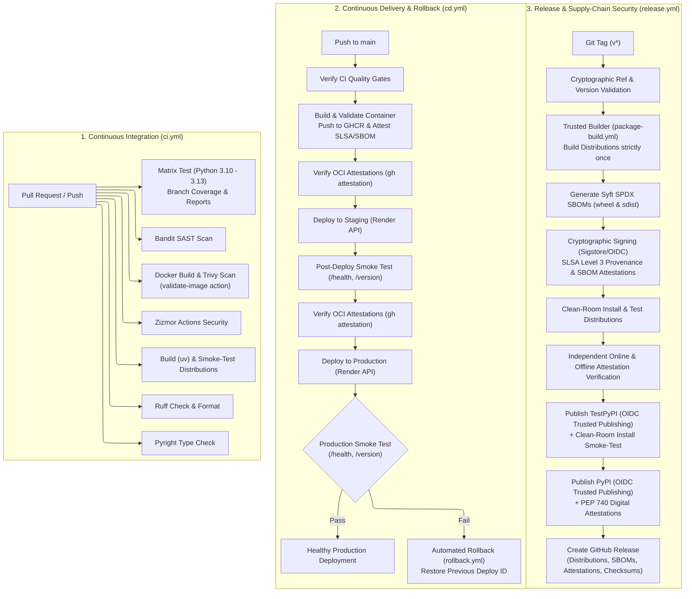

## System Architecture & Delivery Lifecycle

The software delivery lifecycle spans three distinct execution phases, each governed by cryptographic verification, automated testing, and quality gates:

